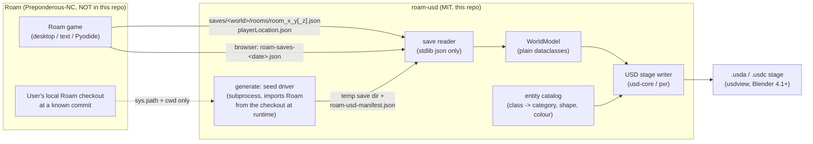

# Architecture

Status: **planning — not yet implemented.** This document describes the intended design. Facts about Roam are cited at commit [`a8d9ad6`](https://github.com/Preponderous-Software/roam/tree/a8d9ad6bc819d02195d047b103b96eb56d55063c); `R/` below is shorthand for `https://github.com/Preponderous-Software/roam/blob/a8d9ad6bc819d02195d047b103b96eb56d55063c/`.

## Overview

roam-usd has two front doors and one back end:

- **`roam-usd export <save>`** reads a Roam world that already exists on disk (or a browser save bundle) and writes a USD stage.
- **`roam-usd generate --seed N`** asks Roam's own world generator to create a world from a seed, has it written in Roam's normal save format, and then hands that save to the exact same exporter.

The single contract between roam-usd and Roam is **Roam's on-disk save format**. Everything downstream of the save reader is independent of Roam's code.



## Components

### 1. Save reader (`roam_usd.save`)

Reads a Roam save directory into an in-memory `WorldModel`. Pure Python, standard library only. It never imports Roam.

What a save directory contains (at `a8d9ad6`):

| File | Written by | Used by roam-usd |
| --- | --- | --- |
| `rooms/room_<x>_<y>.json` (surface, `z == 0`) and `rooms/room_<x>_<y>_<z>.json` (caves, `z < 0`) | `Config.getRoomFilePath` ([`R/src/config/config.py#L366-L373`](https://github.com/Preponderous-Software/roam/blob/a8d9ad6bc819d02195d047b103b96eb56d55063c/src/config/config.py#L366-L373)), `RoomJsonReaderWriter.generateJsonForRoom` ([`R/src/world/roomJsonReaderWriter.py#L109-L185`](https://github.com/Preponderous-Software/roam/blob/a8d9ad6bc819d02195d047b103b96eb56d55063c/src/world/roomJsonReaderWriter.py#L109-L185)) | Yes — the world itself |
| `playerLocation.json` (`roomX`, `roomY`, `roomZ`, `locationId`; `roomZ` is read with a default of 0 for older saves) | `WorldScreenPersistence` ([`R/src/screen/worldScreenPersistence.py#L35-L66`](https://github.com/Preponderous-Software/roam/blob/a8d9ad6bc819d02195d047b103b96eb56d55063c/src/screen/worldScreenPersistence.py#L35-L66)) | Yes — player marker |
| `tick.json` | `TickCounter` | Yes — recorded as stage metadata |
| `playerAttributes.json`, `playerInventory.json`, `stats.json`, `goals.json`, `codex.json` | various | Not in MVP |
| `roompngs/`, map PNGs | `MapImageGenerator` | No |

A room file holds: `backgroundColor` (a Python tuple rendered as a string, e.g. `"(203, 134, 61)"`), `x`, `y`, optional `z` (absent means 0 in older saves), `name`, `id`, `livingEntityIds`, `creationDate`, and `grid` with `columns`, `rows` and a flat list of `locations`. Each location has integer `x`, `y` and an ordered list of `entities`, each with at least `id`, `entityClass`, `name`, `creationDate`, `environmentId`, `gridId`, `locationId`, plus class-specific fields (`energy`, `tickCreated`, `tickLastReproduced`, `imagePath`, `tickPlanted`, `storedInventory`, `npcMode`, `npcInventory`) — see `generateJsonForEntity` ([`R/src/world/roomJsonReaderWriter.py#L156-L185`](https://github.com/Preponderous-Software/roam/blob/a8d9ad6bc819d02195d047b103b96eb56d55063c/src/world/roomJsonReaderWriter.py#L156-L185)).

Reader rules:

- **Grid size is read from each file** (`grid.columns` / `grid.rows`), never assumed to be 17.
- **`roomType` is not in the save.** `Room.roomType` exists in memory ([`R/src/world/room.py`](https://github.com/Preponderous-Software/roam/blob/a8d9ad6bc819d02195d047b103b96eb56d55063c/src/world/room.py)) but `generateJsonForRoom` does not write it. For real saves the biome is recorded as `unknown` (MVP) and the background colour is kept; for generated worlds the driver records it in the manifest.
- **`Player` entity records are skipped**, matching Roam's own loader ([`R/src/world/roomJsonReaderWriter.py#L235-L238`](https://github.com/Preponderous-Software/roam/blob/a8d9ad6bc819d02195d047b103b96eb56d55063c/src/world/roomJsonReaderWriter.py#L235-L238)); the player marker comes from `playerLocation.json`.
- **Unknown `entityClass` values do not fail the export.** They are kept with their class name and rendered with a fallback prototype, with one warning per class.
- **Entity order within a location is preserved**; it drives vertical stacking.
- The reader is a fresh, independent implementation of the field list above. It does not copy or vendor `R/schemas/room.json`.

**Browser save bundles.** The Pyodide build's **Saves** button downloads one JSON document, `{"format": "roam-saves", "version": 1, "game": "roam", "exported": "...", "files": {"/saves/<world>/<path>": <content>}}`, where JSON saves are stored as strings and binary files as `{"base64": ...}` ([`R/web/saves.js#L18-L26`](https://github.com/Preponderous-Software/roam/blob/a8d9ad6bc819d02195d047b103b96eb56d55063c/web/saves.js#L18-L26)). The reader lists the worlds in a bundle and reads one (`--world <name>`) through the same code path as a directory.

### 2. Seed driver (`roam_usd.generate`)

Produces a save directory from a seed by running **Roam's own generator**, so generated worlds are exactly what Roam would make — not an imitation.

- Runs as a **subprocess** using an interpreter the user names (`--roam-python`, default: the current one) with the user's Roam checkout (`--roam <path>`) as working directory and `<path>/src` on `sys.path`. Roam's room loader opens `schemas/room.json` relative to the working directory ([`R/src/world/roomJsonReaderWriter.py#L63-L64`](https://github.com/Preponderous-Software/roam/blob/a8d9ad6bc819d02195d047b103b96eb56d55063c/src/world/roomJsonReaderWriter.py#L63-L64)), and entities carry paths like `assets/images/grass.png`, so the checkout must be the working directory.
- The subprocess entry point (`roam_usd/_driver.py`) is roam-usd's own MIT code. It:
  1. calls `random.seed(seed)` once;
  2. builds Roam's `Map` with Roam's `NullRenderer` ([`R/src/rendering/nullRenderer.py`](https://github.com/Preponderous-Software/roam/blob/a8d9ad6bc819d02195d047b103b96eb56d55063c/src/rendering/nullRenderer.py)) and a minimal stand-in for `Config` / `TickCounter` that points only at a temporary directory — so the user's real Roam config and saves are never read or written;
  3. calls `Map.generateNewRoom(x, y, 0)` for every room within `--radius` in a **fixed spiral order** starting at (0, 0), single-threaded (no `RoomPreloader`);
  4. optionally (`--home`, default on) builds the starting home in (0, 0) with Roam's `StartingHomeGenerator`, as a new game would;
  5. for every generated room containing a `CaveEntrance`, generates the room below it (`z - 1`), down to `--cave-depth` (Roam's own limit is `DEEPEST_Z = -3`, [`R/src/screen/worldScreen.py#L86`](https://github.com/Preponderous-Software/roam/blob/a8d9ad6bc819d02195d047b103b96eb56d55063c/src/screen/worldScreen.py#L86));
  6. writes each room with Roam's own `RoomJsonReaderWriter.generateJsonForRoom`, so the output is a genuine Roam save;
  7. writes `roam-usd-manifest.json`: seed, radius, cave depth, generation order, each room's `roomType`, Roam's commit SHA (from `git -C <checkout> rev-parse HEAD`, or `unknown`), Roam's `version.txt`, and the Python version.
- **Why a subprocess:** Roam has its own dependencies (`structlog`, `jsonschema`, …, [`R/requirements.txt`](https://github.com/Preponderous-Software/roam/blob/a8d9ad6bc819d02195d047b103b96eb56d55063c/requirements.txt)) and import-time expectations (working directory, top-level package names like `entity`, `world`, `config`). Isolating it keeps roam-usd's own environment clean and keeps the coupling to one documented seam. World generation was checked during planning to need neither pygame nor a display.
- **Determinism contract:** same seed + same Roam commit + same Python minor version + same flags ⇒ same world (tile contents, room types, colours). Entity/grid UUIDs are `uuid4` and are **not** reproducible; roam-usd never uses them in prim paths.

### 3. Entity catalog (`roam_usd.catalog`)

A table, written for this project, mapping each `entityClass` to a category, a prototype shape, a height, and a flat display colour. Colours are chosen by hand for legibility, not sampled from Roam's art.

### 4. USD stage writer (`roam_usd.usd`)

Builds the stage with `pxr` (from `usd-core`). Writes `.usda` (default, diffable) or `.usdc` (by extension). Output is deterministic: rooms and tiles are emitted in sorted order so the same input yields byte-identical `.usda`.

### 5. CLI (`roam_usd.cli`)

```
roam-usd export <save-dir | bundle.json> [--world NAME] [-o world.usda] [--levels all|surface] [--textures <roam-checkout>]
roam-usd generate --roam <roam-checkout> (--seed N | --seeds A..B) [--radius R] [--cave-depth D] [--no-home] [-o out/]
roam-usd info <save-dir | bundle.json>      # rooms, levels, entity counts; no USD needed
```

`generate --seeds A..B` writes one stage per seed plus `index.usda`, which references every seed's stage laid out on a grid (the "contact sheet").

## Roam → USD mapping

Stage settings: `upAxis = "Z"`, `metersPerUnit = 1`, one tile = 1 × 1 unit, `defaultPrim = /World`.

| Roam concept | Source in save | USD representation |
| --- | --- | --- |
| World / save | save directory or bundle world | `/World` (`Xform`); `customLayerData` holds `roam:source` (`save` or `seed`), save path or seed, Roam commit, Roam version, tick, roam-usd version |
| Level (`z`) | room `z` (missing ⇒ 0) | `/World/Surface` for `z = 0`, `/World/Cave_1`, `/World/Cave_2`, … for `z = -1, -2, …`; translated by `z × levelSpacing` (default 4 units) on Z, so caves sit under the surface |
| Room (`x`, `y`) | `room_<x>_<y>[_<z>].json` | `/World/<Level>/Room_<x>_<y>` (`Xform`); negative coordinates written as `n<abs>` (e.g. `Room_n1_2`) because `-` is not valid in prim names; translated to `(x × columns, −y × rows, 0)` |
| Room background | `backgroundColor` | `Room_…/Ground`: one quad `Mesh` covering the room, `primvars:displayColor` = background colour / 255 |
| Room biome | manifest `roomType` (generated) / not saved (real saves) | `customData["roam:roomType"]` on the room prim (`unknown` for real saves) |
| Tile | `grid.locations[]` with `x`, `y` | Not a prim. A tile is a position `(x + 0.5, −(y + 0.5))` in room space; screen-down `+y` in Roam becomes `−Y` in USD, matching Roam's `getUp` = `y − 1` ([`R/src/lib/pyenvlib/grid.py#L128-L132`](https://github.com/Preponderous-Software/roam/blob/a8d9ad6bc819d02195d047b103b96eb56d55063c/src/lib/pyenvlib/grid.py#L128-L132)) and Roam's adjacent-room logic, where moving up is `roomY − 1` ([`R/src/screen/worldScreen.py#L770-L780`](https://github.com/Preponderous-Software/roam/blob/a8d9ad6bc819d02195d047b103b96eb56d55063c/src/screen/worldScreen.py#L770-L780)) |
| Terrain / ground cover: `Grass`, `CaveFloor`, `WoodFloor`, `StoneFloor` | entity on a location | Instance in `Room_…/Tiles` (`PointInstancer`), thin slab prototype (height 0.1) |
| Solid terrain: `Stone`, `CoalOre`, `IronOre`, `GoldOre` | entity | Instance in `Tiles`, unit-cube prototype |
| Flora: `OakWood`, `JungleWood`, `Leaves` | entity | Instance in `Tiles`; trunk = tall narrow box, leaves = canopy slab raised above the ground |
| Static structures: `Fence`, `Bed`, `StoneBed`, `Campfire`, `Torch`, `GoldenLantern`, `Gravestone`, `CaveEntrance`, `CaveLadder` | entity | Instance in `Tiles`, one prototype each |
| Ground items: `Apple`, `Banana`, `ChickenMeat`, `BearMeat`, `Wheat`, `WheatSeed`, `Excrement` | entity | Instance in `Tiles`, small-cube prototype (scale 0.3) |
| Stateful structures: `Chest`, `IronChest`, `YoungCrop`, `MatureCrop` | entity + `storedInventory` / `tickPlanted` | Individual prim under `Room_…/Structures/<Class>_<tx>_<ty>` referencing the class prototype; `customData` carries the stored inventory summary (class → count) or `tickPlanted` |
| Creatures: `Bear`, `Chicken`, `Deer`, `Rabbit`, `Snake`, `Wolf`, `Npc` | entity with `energy`, `tickCreated`, `tickLastReproduced`, `imagePath` (+ `npcMode`, `npcInventory`) | Individual prim `Room_…/Creatures/<Class>_<tx>_<ty>_<k>` (placeholder capsule/box sized per class); fields as `customData["roam:*"]` |
| Player | `playerLocation.json` (`roomX`, `roomY`, `roomZ` default 0, `locationId`) | `/World/Player` marker prim at the tile whose location `id` equals `locationId`, in room (`roomX`, `roomY`, `roomZ`) |
| Entity stack on one tile | order of `entities[]` | Each entity sits on top of the previous one's height; order is preserved |
| Unknown entity class | any unrecognised `entityClass` | Instance of a magenta fallback cube; `roam:entityClass` recorded |

Per-room `PointInstancer` details: `prototypes` = only the classes present in that room (children of `Tiles/Prototypes`, each a referenced copy of a shared prototype in `/World/Prototypes`), `protoIndices`, `positions`, and `ids` = `tileY × columns + tileX` × 16 + stack index, which is stable and derived from coordinates, not UUIDs. Prim paths never contain Roam UUIDs; UUIDs are kept only as `customData["roam:id"]` on individual prims.

**Textures (opt-in).** With `--textures <roam-checkout>`, prototypes get a `UsdPreviewSurface` material whose `UsdUVTexture` points at the absolute path of the matching PNG inside the user's own Roam checkout (`assets/images/<lowerCamelClass>.png`, e.g. `OakWood → oakWood.png`). Nothing is copied into roam-usd's repository or package; whether a texture is copied into the *output folder* is the user's choice (`--copy-textures`).

## License boundary

Roam is released under the [Preponderous Non-Commercial License (Preponderous-NC)](https://github.com/Preponderous-Software/preponderous-nc-license/blob/main/LICENSE.md), which is source-available and **not** an OSI open-source license. roam-usd is MIT. To keep the MIT repository clean:

1. **No Roam source code** is copied, vendored, or pasted into this repository — not modules, not snippets, not the JSON schemas in `R/schemas/`. The save reader is an independent implementation of a documented data layout.
2. **No Roam assets** (the PNGs in `R/assets/images/`) are committed or packaged. Textures are referenced from a checkout the user already has, at export time, only when asked.
3. **No Roam save files** generated by Roam are committed as test fixtures. Unit-test fixtures are small, hand-written JSON files authored for this repository. Tests that need real Roam output clone Roam at a pinned commit during CI into an ignored directory.
4. **Roam is never a package dependency.** It is not listed in `pyproject.toml`. (The `roam` name on PyPI belongs to an unrelated project.) The seed driver imports Roam's modules at runtime only from a checkout path the user supplies, in a separate process.
5. **Consequence for users:** exporting your own saves needs nothing from Roam. Using `generate` runs Roam's code, so that use is governed by Roam's license (non-commercial use is permitted by it); roam-usd's README says so plainly.

This boundary is the main reason the save format, not Roam's Python API, is the contract.

## Integration decision: standalone save reader, with an optional Roam-driven generator

| Option | Coupling | License | Verdict |
| --- | --- | --- | --- |
| A. Standalone reader of Roam saves | Only to the save format, which Roam already keeps backward compatible (e.g. legacy `room_x_y.json` names kept for `z = 0`, missing `z` read as 0) | Clean: no Roam code involved | **Core of the tool** |
| B. Import Roam's modules (`Map`, `RoomJsonReaderWriter`) in-process for everything | Tight: Roam's import layout, working-directory assumptions, dependency set and class names all become roam-usd's API | Every use of roam-usd would execute NC-licensed code in-process | Rejected as the main path |
| C. Re-implement Roam's generator in roam-usd | None at runtime, but silently drifts from the real game | Re-implementing it closely risks being a derivative of NC code | Rejected |
| D. Use Roam's REST API (`restEnabled`) | Needs a running game; endpoints return summaries, not full tile data ([`R/src/api/restApiServer.py`](https://github.com/Preponderous-Software/roam/blob/a8d9ad6bc819d02195d047b103b96eb56d55063c/src/api/restApiServer.py)) | Clean | Possible future "live" mode, not MVP |

Chosen: **A, plus B confined to the seed driver** — the only place where running Roam's real code is the point, isolated in a subprocess that produces a standard save.

## Dependencies

| Dependency | Version | Why |
| --- | --- | --- |
| Python | ≥ 3.10, < 3.15 (CI: 3.10–3.13; Roam's own CI uses 3.12) | `usd-core` 26.8 declares `>=3.9,<3.15` |
| [`usd-core`](https://pypi.org/project/usd-core/) | `>=26.3,<27` (26.8 current at time of writing, released 2026-07-20) | `pxr.Usd`, `UsdGeom`, `UsdShade`, `Sdf`, `UsdUtils.ComplianceChecker` |
| `pytest` | ≥ 8 (dev) | tests |
| `ruff` | dev | lint/format |
| Roam checkout (optional, `generate` only) | any commit; integration tests pin `a8d9ad6bc819d02195d047b103b96eb56d55063c` | real world generator |
| Roam's runtime deps (optional, in the `--roam-python` env) | per `R/requirements.txt` (`structlog`, `jsonschema`, …); pygame not needed for generation | imported by Roam's world modules |

Viewers (not dependencies): `usdview` (ships with full OpenUSD builds, not with `usd-core`), Blender ≥ 4.1 (USD point-instancer import added in 4.1 per its [release notes](https://developer.blender.org/docs/release_notes/4.1/pipeline_assets_io/)).

## Testing strategy

- **Reader unit tests** against hand-written fixtures: surface + cave rooms, missing `z`, negative coordinates, unknown entity class, `Player` record skipped, non-17 grid size, malformed file → clear error naming the file.
- **Catalog tests:** every class Roam's loader knows at the pinned commit has an entry (the list is checked by the integration job, not copied into unit tests); unknown → fallback.
- **Writer tests:** build a stage from a small `WorldModel`; assert prim paths, `PointInstancer` array lengths agree (`protoIndices`, `positions`, `ids`), instance counts per class equal entity counts per class, coordinates of known tiles, `customLayerData` keys. Golden `.usda` files under `tests/golden/` (byte comparison; regenerated deliberately with `pytest --update-golden`).
- **Stage validity:** every produced stage opens with `Usd.Stage.Open` and passes `UsdUtils.ComplianceChecker` with no errors.
- **Integration (CI job, opt-in locally with `-m roam`):** clone Roam at the pinned SHA into an ignored directory, install its requirements, run `generate --seed 1` twice and `--seed 2` once; assert seed 1 runs produce identical `.usda`, seed 2 differs, and the generated save directory reads back cleanly. A second job exports a world the driver made, to exercise the `export` path on genuine Roam output.
- **Viewer smoke check:** headless Blender (`blender -b --python-expr "import bpy; bpy.ops.wm.usd_import(filepath=...)"`) where available; otherwise a documented manual check in `usdview` and Blender before each release.

## Open questions

1. **Seed support upstream.** Should Roam itself grow a `seed` setting (e.g. a module-level `random.Random(seed)` used by `RoomFactory` and `Map`)? That would make "same seed, same world" true in-game too, at least for a fixed exploration path. roam-usd does not depend on it.
2. **Schema drift.** `roomZ` is written to `playerLocation.json` but is not listed in `R/schemas/playerLocation.json`; roam-usd treats Roam's writer code, not its schemas, as the source of truth. Should roam-usd track a list of "known fields" per Roam version and warn on unexpected ones?
3. **Biome for real saves.** Infer `roomType` from contents (e.g. jungle ⇔ JungleWood present; mountain ⇔ grey background with no Grass) or leave it `unknown`? Or ask Roam to persist `roomType`?
4. **Driver stand-ins.** The driver needs a `Config`-like object for `Map`. Duck-typed stand-in (decoupled, but breaks silently if Roam's `Map` starts calling new methods) vs. Roam's real `Config` (reads the user's Roam config, and `Config.ensureUserConfigExists` may create one in the user-data directory). Current choice: stand-in, with the integration test as the tripwire.
5. **Texture naming.** Living entities store their `imagePath` in the save, but static entities' image paths live only in Roam's code. At the pinned commit, all 31 non-living classes in the save format have a PNG named after its class in lowerCamel case (`OakWood → oakWood.png`). Is that convention stable enough to rely on, or should textures stay a post-MVP feature?
6. **Creature shapes.** Placeholder primitives vs. billboard quads with the sprite (when textures are on)?
7. **Level spacing and caves.** Is stacking caves 4 units below the surface the most useful default, or should caves be exported as separate stages/layers?
