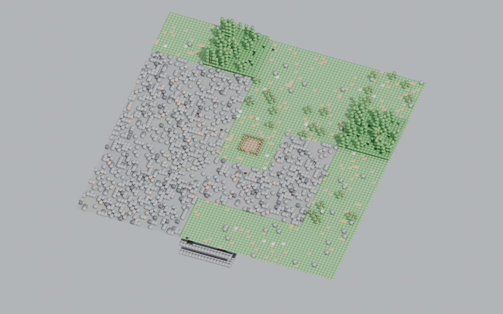
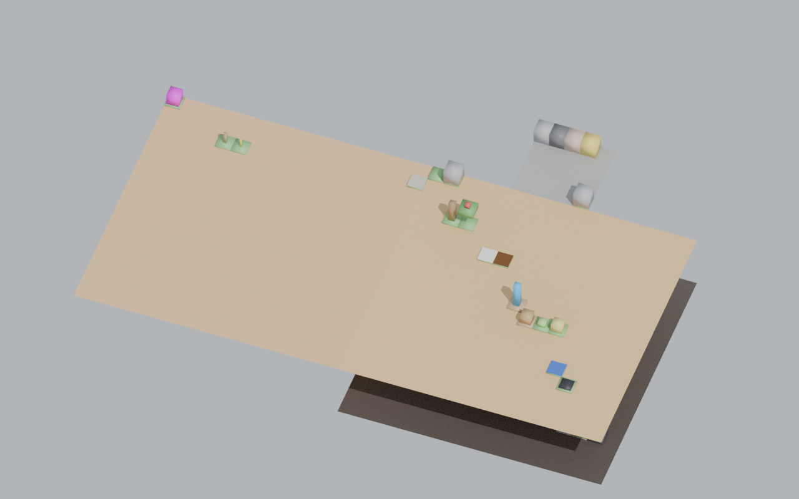
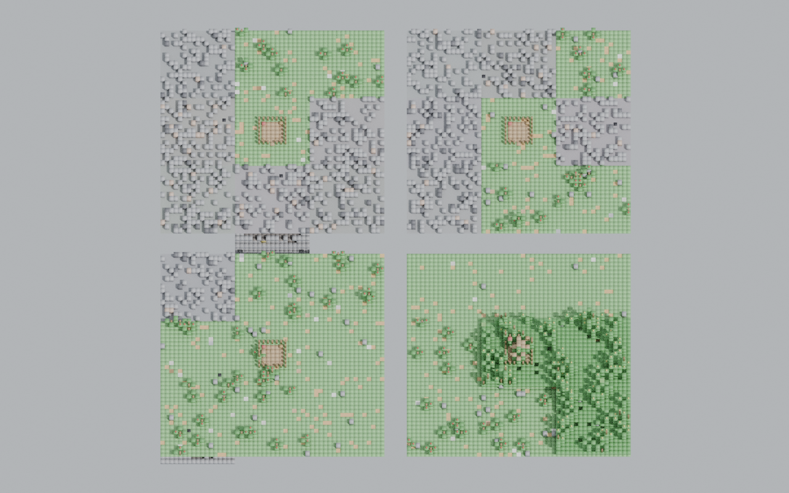
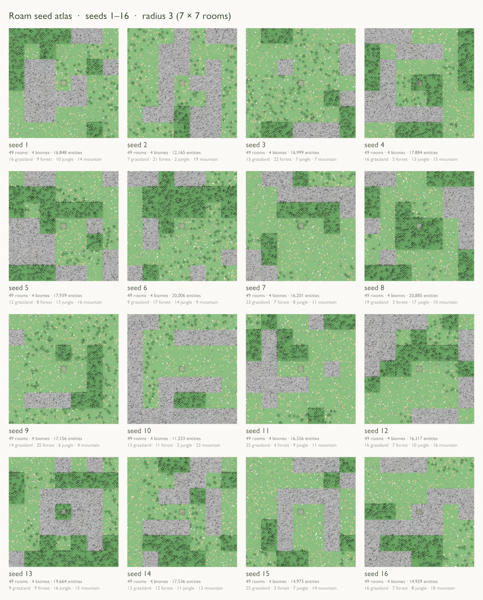

# roam-usd
roam-usd exports worlds from the game [Roam](https://github.com/Preponderous-Software/roam) to [OpenUSD](https://openusd.org/) stages. Tiles, terrain, creatures, structures and items become a 3D scene that opens in `usdview` or Blender — either from a world you explored, or from a fresh world generated by Roam's own world generator from a seed.

> **Status: MVP implemented** (version `0.1.0.dev0`, not yet on PyPI). Every MVP milestone has landed ([`mvp` issues](https://github.com/Preponderous-Software/roam-usd/issues?q=label%3Amvp)). Blender import is verified automatically in CI; a `usdview` check is a manual pre-release step that has not been performed yet (see [Checking the output in viewers](#checking-the-output-in-viewers)).



## Planning Documents
Document | Contents
------------ | -------------
[CONCEPT.md](./CONCEPT.md) | The problem, who it's for, how Roam generates its world, non-goals, prior art
[MVP.md](./MVP.md) | The smallest end-to-end slice, scope, acceptance criteria, milestones
[ARCHITECTURE.md](./ARCHITECTURE.md) | Components, data flow, Roam → USD mapping, license boundary, dependencies, testing, decisions, open questions

The MVP milestones are tracked as GitHub issues with the [`mvp`](https://github.com/Preponderous-Software/roam-usd/issues?q=label%3Amvp) label.

## Install
roam-usd needs Python 3.10 – 3.13. Its only runtime dependency is [`usd-core`](https://pypi.org/project/usd-core/) 26.x.

```
pip install git+https://github.com/Preponderous-Software/roam-usd
```
or, from a clone, `pip install .`. Roam itself is never installed by roam-usd.

## Usage
Command | Effect
------ | ------
`roam-usd export <save-dir> -o world.usda` | Export a Roam save folder (e.g. `saves/defaultsavefile`) to a text `.usda` stage
`roam-usd export <save-dir> --binary -o world.usdc` | The same, written as binary `.usdc`
`roam-usd export <save-dir> --levels surface` | Leave out the cave levels
`roam-usd export <save-dir> --roam <roam-checkout> -o world.usda` | Also texture the creature sprite cards from your Roam clone
`roam-usd export roam-saves-<date>.json --world save_1 -o world.usda` | Export one world from a browser save download (the **Saves** button in Roam's browser build)
`roam-usd generate --roam <roam-checkout> --seed 7 --radius 3 -o out/` | Generate a 7×7-room world from seed 7 with Roam's own generator, then export it to `out/seed_7.usda`
`roam-usd generate --roam <roam-checkout> --seeds 1..16 -o out/` | Generate and export 16 worlds, plus `out/index.usda` showing them side by side (`--seeds 1,5,9` lists seeds; a list starting with a negative seed needs `=`, as in `--seeds=-2..1`)
`roam-usd info <save-dir or bundle.json> [--world NAME]` | Print rooms per level, entity counts per class and the player position; for a bundle, list its worlds

`export` writes `world.usda` (or `world.usdc` with `--binary`) when `-o` is not given; `generate` writes to `out/`. Run `roam-usd <command> --help` for every option (`generate` also has `--binary`, `--cave-depth 0-3`, `--no-home`, `--roam-python` and `--keep-saves`).

### Where Roam keeps its saves
Each world is a folder under Roam's saves directory; the default world is `defaultsavefile` ([`Config.getSavesBaseDirectory`](https://github.com/Preponderous-Software/roam/blob/a8d9ad6bc819d02195d047b103b96eb56d55063c/src/config/config.py#L82-L102) at the pinned commit):

Platform | Saves directory
------ | ------
Windows | `%APPDATA%\Roam\saves\`
macOS | `~/Library/Application Support/Roam/saves/`
Linux / running from source | `saves/` inside the Roam folder the game runs from
Any (override) | the directory in the `ROAM_SAVE_DIR` environment variable

In the browser build, the **Saves** button downloads every world as one `roam-saves-<date>.json` file; pass it to `export` or `info` directly and pick a world with `--world` (`info` lists the names).

### Generating worlds from seeds
`generate` runs Roam's own world generator from your Roam clone, in a separate process, so the interpreter that runs it needs Roam's Python requirements: `pip install -r <roam-checkout>/requirements.txt`, or point `--roam-python` at an interpreter that has them. Your Roam config and saves are never read or written.

Roam has no world seed of its own yet ([roam#600](https://github.com/Preponderous-Software/roam/issues/600)), so roam-usd seeds Python's shared `random` module before generating rooms in a fixed spiral order. A seed therefore identifies a world *as generated by roam-usd*: the same seed, Roam commit, Python minor version and flags give a byte-identical stage, but it is not a world you can re-create inside the game.

**License note:** `generate` runs Roam's code, so that use is governed by Roam's license, the [Preponderous Non-Commercial License](https://github.com/Preponderous-Software/preponderous-nc-license/blob/main/LICENSE.md). Exporting your own saves runs no Roam code.

### What ends up in the scene
Roam | USD
------------ | -------------
Room | `Xform` at its place in the world, with a ground quad in the room's background colour and its biome (`roomType`) when the save records it, otherwise `unknown`
Tiles (grass, stone, ore, trees, leaves, floors, fences, items, ...) | One `PointInstancer` per room, one prototype per entity class
Creatures, NPCs | Sprite cards — flat quads textured with Roam's own sprites, read from your Roam clone at export time — carrying Roam's data (energy, ticks) as `customData`
Chests, crops | Individual prims carrying Roam's data (contents, ticks) as `customData`
Cave levels | Stacked beneath the surface in the same stage, 4 units per level
Player | A marker prim at the saved position

The full mapping is in [ARCHITECTURE.md](./ARCHITECTURE.md#roam--usd-mapping).

## Screenshots
The images on this page were rendered headlessly in Blender from roam-usd's output: the first three in Blender 4.2 with [`scripts/blender_check.py`](./scripts/blender_check.py) (Cycles on the CPU), the seed atlas with [`scripts/seed_atlas.py`](./scripts/seed_atlas.py).

The repository's hand-written test save (`tests/fixtures/saves/basic`): instanced tiles on the room grounds, a magenta fallback cube for an unknown entity class, a chest and crops, the blue player marker, creature sprite cards (textured here with plain-colour test sprites generated for this repository) and the cave level 4 units below the surface:



`roam-usd generate --seeds 1..4 --radius 1` — four worlds from Roam's own generator, side by side in `index.usda`:



A seed atlas: sixteen worlds, `roam-usd generate --seeds 1..16 --radius 3 --cave-depth 0` (7×7 surface rooms each, with the starting home in the centre), seen from straight above in roam-usd's catalog colours. Each label gives the seed, the rooms, how many rooms of each biome the generator chose, and the entity count. Rendered in Blender 5.2 with [`scripts/seed_atlas.py`](./scripts/seed_atlas.py) (Cycles on the CPU), then reduced to 96 colours to keep the file small:



```
roam-usd generate --roam <roam-checkout> --seeds 1..16 --radius 3 --cave-depth 0 -o out/
blender --background --python scripts/seed_atlas.py -- out/seed_{1..16}.usda --width 2000 -o atlas.png
```

The generated-world images show display colours only (`blender_check.py --flat`, and `seed_atlas.py` without `--textured`), so no Roam artwork appears in this repository; with `--roam`, creature cards show Roam's sprites from your own clone, and `seed_atlas.py --textured --roam <roam-checkout>` also textures the tiles with them — such posters fall under Roam's license and are for your own use.

## Checking the output in viewers
- **Blender 4.1+** (File → Import → Universal Scene Description): imports levels, ground, point-instanced tiles, creature cards with their sprite textures, structures and the player. CI's `Blender import smoke (bpy 4.2)` job checks this on every push.
- **usdview** ships with full OpenUSD builds, not with `usd-core`, so it cannot run in CI. Before a release, open a fixture export and a generated world (`usdview world.usda`) and check that ground, tiles, creature cards (with `--roam`, textured), structures, the player marker and the cave levels below the surface are all visible, and that `index.usda` shows every seed without overlap. This check has not been performed yet.

## Relationship to Roam
roam-usd **reads** Roam; it does not contain it.

- Exporting a save needs only the save files. No Roam code runs.
- `generate` needs a local clone of Roam and runs Roam's world generator from it in a separate process. That use of Roam is governed by Roam's own license, the [Preponderous Non-Commercial License](https://github.com/Preponderous-Software/preponderous-nc-license/blob/main/LICENSE.md).
- Creature sprites are read from your own Roam clone at export time when you pass `--roam` (and always by `generate`); they are not shipped with roam-usd.
- No Roam source code, schemas, art or save files are copied into this repository. See [ARCHITECTURE.md § License boundary](./ARCHITECTURE.md#license-boundary).

## Requirements
- Python 3.10 – 3.13
- [`usd-core`](https://pypi.org/project/usd-core/) 26.x
- For `generate`: a clone of [Roam](https://github.com/Preponderous-Software/roam) and Roam's Python requirements
- To view results: `usdview` or Blender 4.1+

## Development
```
pip install -e ".[dev]"
ruff check . && ruff format --check .
python -m pytest                       # unit, golden and stage-validity tests
ROAM_USD_ROAM_CHECKOUT=<roam-checkout> python -m pytest -m roam     # against a real Roam clone
ROAM_USD_BLENDER_PYTHON=<python-with-bpy> python -m pytest -m blender   # Blender import (bpy 4.2, Python 3.11)
```
Golden files in `tests/golden/` are rewritten only on purpose, with `python -m pytest --update-golden`. CI runs lint and tests on Python 3.10 – 3.13, the Roam integration tests against Roam at the pinned commit, and the Blender import smoke test; a separate `USD asset gate` workflow checks the committed and freshly generated stages with [usd-asset-gate](https://github.com/Preponderous-Software/usd-asset-gate) (see [ARCHITECTURE.md § Testing strategy](./ARCHITECTURE.md#testing-strategy)).

## Support
You can find the support discord server [here](https://discord.gg/49J4RHQxhy).

## Authors and acknowledgement
### Developers
Name | Main Contributions
------------ | -------------
Daniel McCoy Stephenson | Creator

## 📄 License
roam-usd is licensed under the [MIT License](./LICENSE).

Roam itself is a separate project under the Preponderous Non-Commercial License; roam-usd's MIT license does not extend to Roam.
